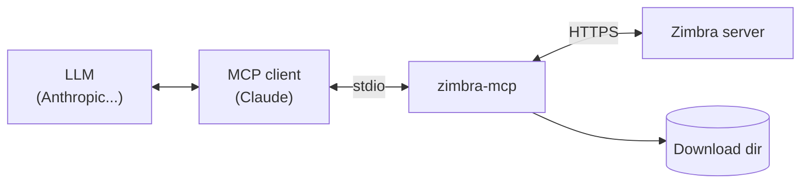
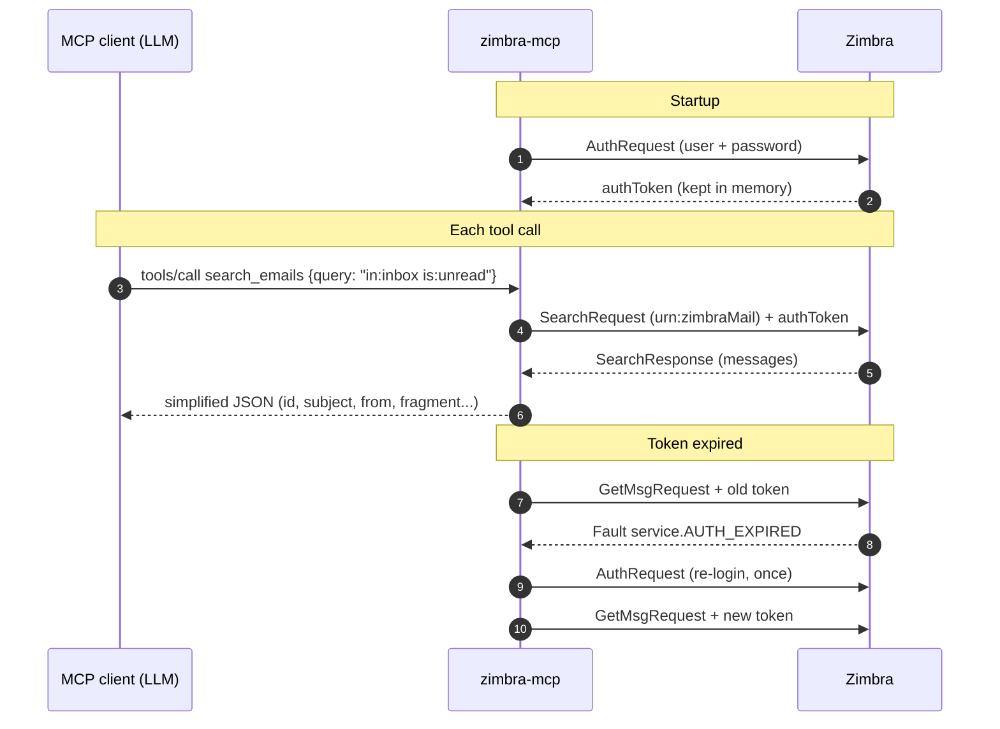

# Zimbra MCP Server

MCP (Model Context Protocol) server for Zimbra to manage emails, tags, calendar, and contacts.

## Installation

```bash
cd ~/Projets/MCP/zimbra-mcp

# With uv
uv sync

# Or with pip
pip install -e .
```

## Configuration

Create a `.env` file from the example:

```bash
cp .env.example .env
```

Configure your Zimbra credentials:

```env
ZIMBRA_URL=https://zimbra.example.com/service/soap
ZIMBRA_USER=me@example.com
ZIMBRA_PASSWORD=your_password
ZIMBRA_TIMEOUT=30
ZIMBRA_ENABLE_SEND=false
```

| Variable | Description | Default |
|----------|-------------|---------|
| `ZIMBRA_URL` | Zimbra SOAP endpoint URL | (required) |
| `ZIMBRA_USER` | Zimbra account email | (required) |
| `ZIMBRA_PASSWORD` | Zimbra account password | (required) |
| `ZIMBRA_TIMEOUT` | Request timeout in seconds (SOAP, auth and downloads) | `30` |
| `ZIMBRA_ENABLE_SEND` | Enable `send_email` tool (`true`/`1`/`yes`) | `false` |
| `ZIMBRA_ENABLE_HARD_DELETE` | Allow permanent deletion of emails/contacts (`hard_delete=True`) | `false` |
| `ZIMBRA_DOWNLOAD_DIR` | The only directory `download_attachment` may write into | `~/Downloads` |
| `ZIMBRA_MAX_ATTACHMENT_MB` | Maximum attachment size downloaded | `50` |
| `ZIMBRA_ALLOW_INSECURE_HTTP` | Accept a plain `http://` `ZIMBRA_URL` (credentials sent unencrypted) | `false` |

## Usage

### Start the server

```bash
uv run zimbra-mcp
```

### Test with MCP Inspector

```bash
mcp dev src/zimbra_mcp/server.py
```

## Available Tools

### Emails

| Tool | Description |
|------|-------------|
| `search_emails` | Search with Zimbra syntax (in:inbox, from:, tag:, etc.) |
| `get_email` | Retrieve an email by ID with full body |
| `download_attachment` | Download an attachment to a local file (inside `ZIMBRA_DOWNLOAD_DIR` only, never overwrites) |
| `list_folders` | List all mail folders |
| `search_folder` | Search for a folder by name or path (case-insensitive partial match) |
| `move_emails` | Move emails to a folder |
| `mark_as_read` | Mark emails as read or unread |
| `delete_emails` | Delete emails (Trash by default; hard delete requires `ZIMBRA_ENABLE_HARD_DELETE=true`) |
| `create_draft` | Create a draft with optional reply/forward support |
| `send_email` | Send an email directly (opt-in, requires `ZIMBRA_ENABLE_SEND=true`) |

#### Reply & Forward Drafts

`create_draft` and `send_email` support linking to an original message for replies and forwards:

| Parameter | Description |
|-----------|-------------|
| `orig_msg_id` | ID of the original message |
| `reply_type` | `"r"` for reply, `"w"` for forward |
| `include_original` | `"inline"` to quote in body, `"attachment"` to attach as .eml |

Examples:
- **Simple draft:** `create_draft(to=[...], subject="...", body="...")`
- **Reply with quote:** `create_draft(to=[...], subject="Re: ...", body="...", orig_msg_id="123", reply_type="r", include_original="inline")`
- **Forward as attachment:** `create_draft(to=[...], subject="Fwd: ...", body="...", orig_msg_id="123", reply_type="w", include_original="attachment")`

#### Zimbra Search Syntax

**Basic operators:**
- `in:inbox` - Emails in inbox
- `from:john@example.com` - Emails from John
- `to:me` - Emails sent to me
- `tag:important` - Emails with "important" tag
- `subject:meeting` - Subject containing "meeting"
- `has:attachment` - Emails with attachments
- `after:2024-01-01 before:2024-12-31` - Date range (ISO or MM/DD/YYYY)
- `is:unread` - Unread emails
- `is:flagged` - Flagged emails

**Boolean operators:**
- `from:john OR from:mary` - Emails from John OR Mary
- `NOT is:read` or `-is:read` - Unread emails (exclusion)
- `(from:john OR from:mary) subject:urgent` - Parentheses for grouping

**Combinations:** `in:inbox from:boss tag:urgent is:unread`

### Contacts

| Tool | Description |
|------|-------------|
| `search_contacts` | Search contacts (all fields). Use `"*"` or empty for all |
| `get_contact` | Retrieve a contact by ID |
| `create_contact` | Create a contact (name, email, phone, company, etc.) |
| `update_contact` | Update specific fields of an existing contact |
| `delete_contact` | Delete contacts (Trash by default; hard delete requires `ZIMBRA_ENABLE_HARD_DELETE=true`) |

### Tags

| Tool | Description |
|------|-------------|
| `list_tags` | List all tags with colors |
| `create_tag` | Create a tag (name, color) |
| `delete_tag` | Delete a tag |
| `add_tag_to_emails` | Add a tag to emails |
| `remove_tag_from_emails` | Remove a tag |

Available colors: blue, cyan, green, purple, red, yellow, pink, gray, orange

### Calendar

| Tool | Description |
|------|-------------|
| `get_calendar_events` | Events over a period |
| `get_event_details` | Full details of an event |
| `create_event` | Create an event |
| `get_free_busy` | User availability |

## How it works

### Architecture and data flow

The server runs **locally**, as a child process of the MCP client (Claude Desktop, Claude Code...). It talks to the client over **stdio** and to **your Zimbra server only**: there is no other backend, no telemetry and no local database.



**Where your data goes**

| Data | Path | Stored where? |
|------|------|---------------|
| Password | `.env` → `zimbra-mcp` → Zimbra (`AuthRequest`, once at startup and on token expiry) | Never sent to the MCP client nor the LLM |
| Auth token | Zimbra → `zimbra-mcp` (memory only) → Zimbra (SOAP header / `ZM_AUTH_TOKEN` cookie) | In memory; never in URLs, never returned by a tool |
| Emails, contacts, events, tags | Zimbra → `zimbra-mcp` → MCP client → **LLM provider** | Wherever your MCP client keeps conversations |
| Attachments | Zimbra → `zimbra-mcp` → file in `ZIMBRA_DOWNLOAD_DIR` | Local disk only (only path/size/type go back to the LLM) |
| Drafts / sent emails | LLM → MCP client → `zimbra-mcp` → Zimbra | Your Zimbra mailbox |

> Everything a tool returns (email bodies, contact details...) becomes part of the conversation and is therefore sent to your LLM provider.

### Lifecycle of a tool call



### Tool → Zimbra API mapping

| Tool(s) | Zimbra call | Effect |
|---------|-------------|--------|
| `search_emails`, `search_contacts` | `SearchRequest` | read |
| `get_email` | `GetMsgRequest` | read |
| `list_folders`, `search_folder` | `GetFolderRequest` | read |
| `move_emails`, `mark_as_read`, `delete_emails`, `add_tag_to_emails`, `remove_tag_from_emails` | `MsgActionRequest` (`move`, `read`, `trash`/`delete`, `tag`/`!tag`) | modify |
| `create_draft` | `SaveDraftRequest` (+ `GetMsgRequest` to quote the original) | create |
| `send_email` *(opt-in)* | `SendMsgRequest` | **sends an email** |
| `download_attachment` | `GET /service/home/~/?id=…&part=…` (REST) | read + local file write |
| `list_tags` / `create_tag` / `delete_tag` | `GetTagRequest` / `CreateTagRequest` / `TagActionRequest` | read / create / delete |
| `get_calendar_events` | `SearchRequest` (`types=appointment`) | read |
| `get_event_details` | `GetAppointmentRequest` | read |
| `create_event` | `CreateAppointmentRequest` | create (invites attendees) |
| `get_free_busy` | `GetFreeBusyRequest` | read |
| `get_contact` / `create_contact` / `update_contact` / `delete_contact` | `GetContactsRequest` / `CreateContactRequest` / `ModifyContactRequest` / `ContactActionRequest` | read / create / modify / delete |

## Security

The content of emails is controlled by their senders. A malicious email can contain instructions aimed at the LLM (*prompt injection*), so the server limits what a manipulated model can do:

- **No sending by default**: `send_email` only exists when `ZIMBRA_ENABLE_SEND=true`. Drafts are always safe to create.
- **No irreversible deletion by default**: `hard_delete=True` is refused unless `ZIMBRA_ENABLE_HARD_DELETE=true`; emails and contacts go to the Trash.
- **Confined file writes**: `download_attachment` only writes inside `ZIMBRA_DOWNLOAD_DIR`, strips any path from the file name (`../../.bashrc` → `bashrc`), never overwrites an existing file and caps the size (`ZIMBRA_MAX_ATTACHMENT_MB`).
- **Credentials**: HTTPS is required unless explicitly overridden; the auth token is sent as a cookie (never in a URL that could end up in proxy logs), redirects are refused so it cannot be forwarded to another host; the password is never included in error messages or `repr()`.
- **Timeouts** on every request, so a hung server cannot block the MCP client forever.

Keep `.env` out of version control (it is in `.gitignore`) and prefer an application-specific password if your Zimbra supports it.

## Development

### Running tests

```bash
# Install test dependencies
uv sync --extra test

# Run tests
uv run pytest

# Verbose output
uv run pytest -v
```

### Test structure

Tests use `unittest.mock` to mock the Zimbra SOAP client, so no Zimbra server is needed. The `capture_tools` fixture in `conftest.py` intercepts `@mcp.tool()` decorators to access tool functions directly.

## Claude Code Integration

Add to your MCP configuration (`~/.claude/settings.json`):

```json
{
  "mcpServers": {
    "zimbra": {
      "command": "uv",
      "args": ["run", "--directory", "/home/me/Projets/MCP/zimbra-mcp", "zimbra-mcp"],
      "env": {
        "ZIMBRA_URL": "https://zimbra.example.com/service/soap",
        "ZIMBRA_USER": "me@example.com",
        "ZIMBRA_PASSWORD": "your_password"
      }
    }
  }
}
```

## Project Structure

```
zimbra-mcp/
├── pyproject.toml
├── README.md
├── .env.example
├── src/
│   └── zimbra_mcp/
│       ├── __init__.py
│       ├── server.py          # FastMCP entry point
│       ├── config.py          # Configuration
│       ├── client.py          # Zimbra SOAP client
│       ├── errors.py          # Exceptions
│       └── tools/
│           ├── __init__.py
│           ├── emails.py      # Email tools
│           ├── tags.py        # Tag tools
│           ├── contacts.py    # Contact tools
│           └── calendar.py    # Calendar tools
└── tests/
    ├── conftest.py            # Shared fixtures
    ├── test_config.py
    ├── test_errors.py
    ├── test_client.py
    └── tools/
        ├── test_emails.py
        ├── test_tags.py
        ├── test_contacts.py
        └── test_calendar.py
```
